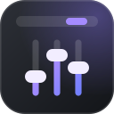
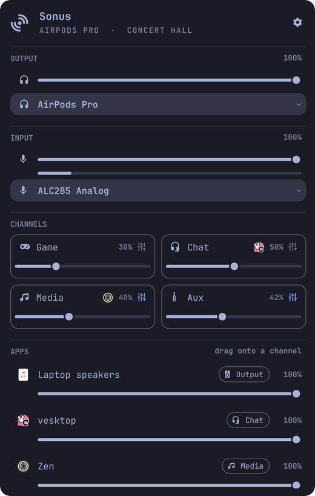

<div align="center">
  
  <h1>Sonus</h1>
  <p>A Sonar-style mixer for <b>PipeWire</b> that drops down from the Omarchy bar:<br/>
  system output and input, <b>Game, Chat, Media and Aux</b> channels, a saved mix per device, and a 10-band EQ.</p>
  <p>
    
    
    
    <a href="https://github.com/T3lluz/omarchy-sonus/actions/workflows/ci.yml"></a>
    
  </p>
  <p><a href="#install"><b>Install</b></a> · <a href="#features">Features</a> · <a href="#use">Use</a> · <a href="#how-it-works">How it works</a></p>
  
</div>

## Features

- **Output and input:** the system volume, mute, and the device list live in the panel. Choosing an output switches the system to it. The microphone has its own level, mute and a live meter.
- **A mix per device:** AirPods keep one volume and equalizer, the laptop speakers keep another. The first time a device is used it starts from the mix you already have; after that, coming back restores it.
- **Channels:** Game, Chat, Media and Aux are real PipeWire sinks, each with its own volume and mute, all mixed into the selected output.
- **Routing:** drag an app onto a channel, or pick one from its button. Routes are remembered and enforced whenever the app starts playing again, panel open or not. Drop an app on the Output section to unassign it.
- **EQ per channel:** ten octave bands from 32 Hz to 16 kHz with a preamp, presets (Flat, Bass, Voice, Treble, Steps), a smooth curve through the faders, and a bypass switch. Changes apply to the running graph with no gap. The curve is saved with the output device.
- **Keyboard first:** every row, fader and band is reachable without the mouse.
- **No gap on reload:** the channels run as the user unit `sonus-graph.service`, so a shell restart or plugin reload adopts the running graph instead of rebuilding it.
- **Updates from the panel:** Settings says when a new version is on GitHub, what changed, and installs it with one click. Edits you made in the plugin folder are set aside with `git stash`, not lost (and dropped when they already are the new version), and a notification says when it is done.
- **Plays well with EasyEffects:** channel outputs land in EasyEffects when it runs, and Sonus keeps it from EQ-ing twice or stealing streams.
- It is the [Sonus](https://github.com/T3lluz/Sonus) desktop app rebuilt as a native Omarchy panel, and shares its settings, so routes and EQ curves carry over. While the desktop app runs, routing pauses here and the panel offers **Switch**.

## Install

```bash
omarchy plugin add https://github.com/T3lluz/omarchy-sonus.git --enable
```

Needs PipeWire with `pipewire-pulse` (Omarchy's default): `pw-dump`, `pw-cli`, `wpctl` and `pactl`. The engine is Python 3, standard library only.

Bind a hotkey in `~/.config/hypr/bindings.lua`:

```lua
o.bind("CTRL + ALT + V", "Sonus", "omarchy-shell sonus toggle")
```

## Use

| Input | Action |
|---|---|
| Click the bar icon | Open the panel |
| Scroll / middle-click the icon | Output volume / mute |
| Click the current output or input | Show the other devices |
| Click an output | Use that device, and its saved volume and EQ |
| Click an input | Use that microphone |
| Right-click the icon | Settings |
| Drag an app onto a channel | Assign it (drop on Output to unassign) |
| App's channel button | Pick a channel |
| Sliders icon on a channel | That channel's EQ |
| `j`/`k`, `h`/`l` | Move, volume |
| `m`, `e`, `1`–`4` / `0`, `s`, `esc` | Mute, EQ, assign / unassign, settings, back |
| In the EQ: `h`/`l`, `j`/`k`, `0`, `p` | Pick a band, move it, zero it, next preset |

## Commands

```bash
omarchy-shell sonus toggle          # open | close | show | hide
omarchy-shell sonus eq chat         # open one channel's EQ: game | chat | media | aux
omarchy-shell sonus settings
omarchy-shell sonus takeover        # retire the Sonus desktop app: stop it, remove its autostart
omarchy-shell sonus update          # install a waiting update, or check for one
omarchy-shell sonus status          # JSON: engine, master volume, apps, output
```

## How it works

- `bin/sonus-engine` (Python, stdlib only) owns the PipeWire side: the filter-chain sinks with the EQ, route enforcement, and keeping EasyEffects from double-EQ-ing or stealing streams. `Service.qml` runs it and talks JSON lines with it over stdin and stdout.
- The channel graph runs as the transient user unit `sonus-graph.service`, so it outlives the shell.
- `Panel.qml` and `ui/` draw the bar icon and panel, one per monitor, all reading the one service.
- Settings live in `~/.config/sonusdeck/settings.json`, shared with the desktop app.

- Updates run `omarchy plugin update` in the transient unit `sonus-update.service`: the update rewrites the plugin folder, the shell reloads Sonus mid-way, and a runner of its own survives that. Its output is in `~/.local/state/sonus/update.log`.

Stop the channels with `python3 -I bin/sonus-engine --stop-graph`.

## Development

```bash
node tests/eq.test.js
python3 -B -m unittest discover tests
omarchy restart shell    # pick up QML changes
```

The tests check that the panel's EQ model (`ui/Eq.js`) and the engine's (`engine/sonus/eq.py`) agree on the band layout. See [AGENTS.md](AGENTS.md) for how the pieces fit.

## License

MIT. Not affiliated with SteelSeries.

One of a set of Omarchy plugins: [Batteries](https://github.com/T3lluz/omarchy-batteries) · [ROG Deck](https://github.com/T3lluz/omarchy-rog-deck) · **Sonus** · [Server Dashboard](https://github.com/T3lluz/omarchy-server-dashboard)
