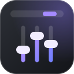
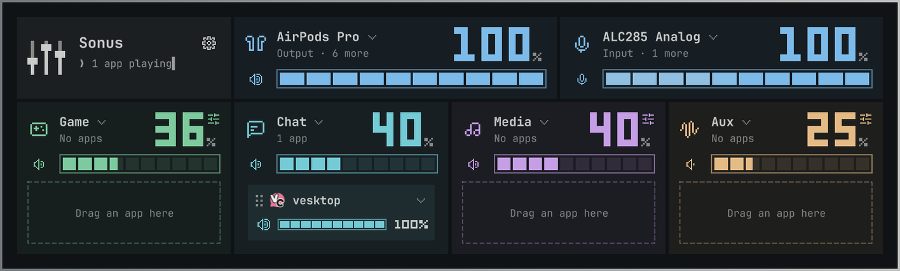

<div align="center">
  
  <h1>Sonus</h1>
  <p>A Sonar-style mixer for <b>PipeWire</b> that drops down from the Omarchy bar:<br/>
  system output and input, <b>Game, Chat, Media and Aux</b> channels, a saved mix per device, and a 10-band EQ.</p>
  <p>
    
    
    
    <a href="https://github.com/T3lluz/omarchy-sonus/actions/workflows/ci.yml"></a>
    
  </p>
  <p><a href="#install"><b>Install</b></a> · <a href="#features">Features</a> · <a href="#use">Use</a> · <a href="#how-it-works">How it works</a></p>
  
</div>

## Features

- **Rooms:** every device and channel is a room in a colour of its own from your theme, its volume in big block digits over a meter of ten cells. The meter is the fader: click or drag across it. Icons are pixel art, sharp at any scale (apps keep their own), and each acts out what it is, a pixel at a time: a speaker's waves ripple out, headphones tap a beat, the laptop types a line on its screen, a chat types its message, the controller's buttons press, a mute's cross draws across. They play when the panel opens, when you point at or click them, and when what they show changes (a mute, a new device, an app starting to play), then rest. An app's little equaliser bars play while it plays and hold still when it is paused, and the microphone's capsule fills with what it hears. The bar icon is the same mark; muted, its faders are down.
- **A visualizer:** the title room's background is what is playing, in pixel columns from 15 Hz on the left to 15 kHz on the right, fading out toward the top so the title stays readable. It follows the music's own level, so a song turned down still fills the room. [cava](https://github.com/karlstav/cava) listens to the output at 60 frames a second while the panel is open and stops when it closes. Settings can turn it off, and reduced motion turns it off too.
- **Output and input:** each has a room with the system volume and mute. Click it to list every device of that kind; choosing an output switches the system to it. The microphone's meter lights up with what it hears.
- **A mix per device:** AirPods keep one volume and equalizer, the laptop speakers keep another. The first time a device is used it starts from the mix you already have; after that, coming back restores it.
- **See where the sound goes:** the output room names the device in use and how many others there are. It has its own icon (laptop, headphones, headset, AirPods and other earbuds, speaker, monitor). Switching outputs, whether from a keybinding, a cable or Bluetooth, shows a toast with the device's icon and name. Scrolling on the bar icon shows the same icon in the volume toast.
- **Channels:** Game, Chat, Media and Aux are real PipeWire sinks, each with its own volume and mute, all mixed into the selected output. Each channel is a room in a row of four, with its fader on top and a bucket of the apps playing into it along the bottom. Click a channel to switch its EQ on or off, or to edit the curve.
- **Routing:** every app is a card with a grip and its own icon, in its channel's colour. Drag it to another channel's bucket, or click it and pick a channel. While you drag, every room shows where it can land, and a **No channel** strip takes apps that should skip the channels. Routes are remembered and enforced whenever the app starts playing again, panel open or not.
- **EQ per channel:** ten octave bands from 32 Hz to 16 kHz with a preamp, presets (Flat, Bass, Voice, Treble, Steps), a smooth curve through the faders, and a bypass switch. Changes apply to the running graph with no gap. The curve is saved with the output device.
- **Keyboard first:** every room, fader and band is reachable without the mouse.
- **A card on hover:** resting the pointer on the bar icon shows the output, the input and each channel with its level.
- **No gap on reload:** the channels run as the user unit `sonus-graph.service`, so a shell restart or plugin reload adopts the running graph instead of rebuilding it.
- **Updates from the panel:** Settings says when a new version is on GitHub, what changed, and installs it with one click. Edits you made in the plugin folder are set aside with `git stash`, not lost (and dropped when they already are the new version), a notification says when it is done, and the shell restarts to draw the new panel.
- **Plays well with EasyEffects:** channel outputs land in EasyEffects when it runs, and Sonus keeps it from EQ-ing twice or stealing streams.
- It is the [Sonus](https://github.com/T3lluz/Sonus) desktop app rebuilt as a native Omarchy panel, and shares its settings, so routes and EQ curves carry over. While the desktop app runs, routing pauses here and the panel offers **Switch**.

## Install

```bash
omarchy plugin add https://github.com/T3lluz/omarchy-sonus.git --enable
```

Needs PipeWire with `pipewire-pulse` (Omarchy's default): `pw-dump`, `pw-cli`, `wpctl` and `pactl`. The engine is Python 3, standard library only.

The visualizer needs `cava`, from Arch's extra repository. The first time a version of Sonus starts without it, Sonus installs it with `pacman`, and the shell asks for your password. If you close that prompt, Settings has an **Install** button.

**Ctrl+Alt+V** opens the panel. Sonus writes that bind into `~/.config/hypr/bindings.lua` itself (and unbinds anything else on the same chord first), so it wins on a fresh install and after another tool reclaims the keys.

## Use

| Input | Action |
|---|---|
| `Ctrl+Alt+V` | Open / close the panel |
| Click the bar icon | Open the panel |
| Scroll / middle-click the icon | Output volume / mute |
| Click the output or input room | List the devices |
| Click an output | Use that device, and its saved volume and EQ |
| Click an input | Use that microphone |
| Right-click the icon | Settings |
| Click or drag across a meter | Set that volume; right-click mutes |
| Drag an app's card to another room | Move it to that channel (or to **No channel**) |
| Click an app's card | Pick a channel from a row of icons |
| Click the speaker beside a meter | Mute it |
| Click a channel's room | Its EQ: on or off, and **Edit the curve** |
| `j`/`k`, `h`/`l` | Move, volume |
| `enter` | Open the room under the cursor: the devices, a channel's EQ, an app's channels |
| `m`, `e`, `1`–`4` / `0`, `s`, `esc` | Mute, EQ, assign / unassign, settings, back |
| In the EQ: `h`/`l`, `j`/`k`, `0`, `p` | Pick a band, move it, zero it, next preset |

## Commands

```bash
omarchy-shell sonus toggle          # open | close | show | hide
omarchy-shell sonus eq chat         # open one channel's EQ: game | chat | media | aux
omarchy-shell sonus settings
omarchy-shell sonus takeover        # retire the Sonus desktop app: stop it, remove its autostart
omarchy-shell sonus update          # install a waiting update, or check for one
omarchy-shell sonus status          # JSON: engine, master volume, apps, output
omarchy-shell sonus previewNotices  # show the update notifications on made-up values
```

## How it works

- `bin/sonus-engine` (Python, stdlib only) owns the PipeWire side: the filter-chain sinks with the EQ, route enforcement, and keeping EasyEffects from double-EQ-ing or stealing streams. `Service.qml` runs it and talks JSON lines with it over stdin and stdout.
- The channel graph runs as the transient user unit `sonus-graph.service`, so it outlives the shell.
- `Panel.qml` and `ui/` draw the bar icon and panel, one per monitor, all reading the one service.
- Settings live in `~/.config/sonusdeck/settings.json`, shared with the desktop app.
- cava runs only while the mixer is open and something plays, with its config piped in, so nothing is written to disk. Sonus asks for your password to install it only right after an update that says so, or from the Install button in Settings. The install runs as the transient unit `sonus-cava-install.service`, so a shell restart in the middle doesn't end it.
- Updates run `omarchy plugin update` in the transient unit `sonus-update.service`: the update rewrites the plugin folder, the shell reloads Sonus mid-way, and a runner of its own survives that. Its output is in `~/.local/state/sonus/update.log`.

## Remove

Stop the channels and take the Ctrl+Alt+V bind out of `~/.config/hypr/bindings.lua` first, then remove the plugin:

```bash
python3 -I ~/.config/omarchy/plugins/io.github.t3lluz.sonus/bin/sonus-engine --stop-graph
omarchy plugin remove io.github.t3lluz.sonus
```

## Development

```bash
node tests/eq.test.js
node tests/audio.test.js
node tests/model.test.js
node tests/shortcut.test.js
node tests/motion.test.js
python3 -B -m unittest discover tests
omarchy restart shell    # pick up QML changes
```

The tests check that the panel's EQ model (`ui/Eq.js`) and the engine's (`engine/sonus/eq.py`) agree on the band layout, that every device shape the engine reports has an icon, and that every pixel icon the panel names exists. `python3 scripts/fetch-pixel-icons.py` rebuilds the icons from Pixelarticons. See [AGENTS.md](AGENTS.md) for how the pieces fit.

## License

MIT. The panel text is set in [Monocraft](https://github.com/IdreesInc/Monocraft) by Idrees Hassan, bundled in `assets/fonts` under the SIL Open Font License 1.1 (`assets/fonts/OFL.txt`). Not affiliated with SteelSeries.

One of a set of Omarchy plugins: [Batteries](https://github.com/T3lluz/omarchy-batteries) · [ROG Deck](https://github.com/T3lluz/omarchy-rog-deck) · **Sonus** · [Server Dashboard](https://github.com/T3lluz/omarchy-server-dashboard)
